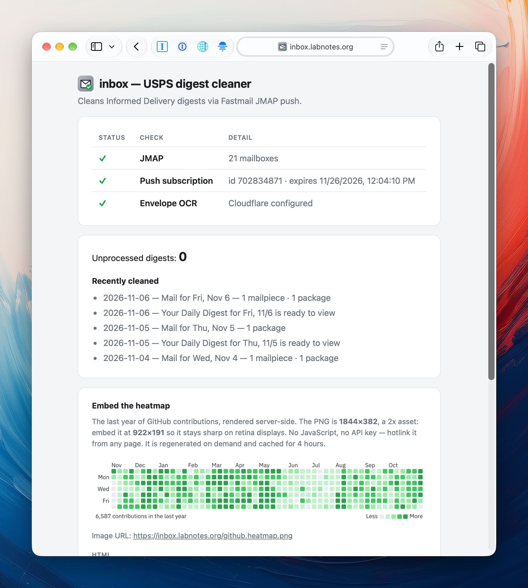

# inbox — clean USPS Informed Delivery, straight back to your Inbox



A self-hosted service that strips the ads from USPS "Informed Delivery" digests
in your own Fastmail inbox. USPS replaces your actual mail scans with ads
(`mailer-*.jpg` / `content-*.jpg`); this app monitors each digest via **Fastmail
JMAP push**, reconstructs a one-page digest (list of packages first, then scans,
then a real "these mailpieces had no scan" note), and moves the clean digest
back into your Inbox — trashing the original.

It runs on **your** Vercel account and connects to **your** Fastmail account.
This is a personal app that you host yourself, not a service you subscribe to.
It also serves an embeddable [GitHub contribution heatmap](#github-contribution-heatmap).

## Prerequisites

- **Fastmail** on a Standard (or higher) plan — API tokens aren't available on
  the Basic plan.
- A **Vercel** account (the free Hobby tier is enough).
- **Node 20+** and **pnpm**.
- **Cloudflare** (optional) — only if you need OCR of the envelope sender name
  in the scans without the `FROM:` label.

## How it works

```diagram
USPS digest received in Fastmail
        │  JMAP StateChange push (RFC 8291 aes128gcm)
        ▼
Vercel /api/push ──decrypt──► process the digest
        │
        ▼
Email/query (unprocessed digests) → download raw MIME
        │
        ▼
parse + strip ads + rebuild (lib/digest.ts) + OCR senders (lib/sender.ts)
        │
        ▼
Email/import into Inbox → mark original read + $usps-processed
```

- **Push**: Fastmail POSTs an encrypted `StateChange` to `/api/push`. The
  subscription is established/renewed via `ensureSubscription()` and `pnpm
setup` and the daily cron. The webhook finishes the `PushVerification`
  handshake.
- **Idempotency**: processed originals are marked with `$usps-processed`
  keyword; the query filters on it. Failed import leaves the original untouched
  for the next push. Each digest is tagged before import to prevent duplicate
  processing on a re-fired push.

### Why it doesn't hallucinate

- **Ad-stripping is a filename deny-list**, not an LLM call: campaign creative is
  always `mailer-*.jpg` / `content-*.jpg`; all other images are actual scans.
- **Senders are taken from the `FROM:` labels first**, then vision. USPS renders
  one `FROM:` label directly above each piece's scan; `mapCidSenders` walks the
  document order and attaches each label to the `cid:` image below it.
  Scans without a label get OCR'd with Cloudflare Workers AI
  (`@cf/meta/llama-3.2-11b-vision-instruct`) — the return address of the sender
  on the envelope. Deterministic (`temperature: 0`), and omitted altogether if
  Cloudflare env vars are not set (these scans show "Unknown sender").
- The digest is parsed from the **text rendering** of the HTML (the visible
  labels "Expected Today", "FROM:", "N item(s)" labels.) USPS can change the
  table structure, but these labels have been stable for years.

Original idea comes from
[ventz/usps-informed-delivery-no-ads](https://github.com/ventz/usps-informed-delivery-no-ads),
which uses Python + SES + S3 + Lambda.

## GitHub contribution heatmap

The same deployment also serves an embeddable picture of a GitHub contribution
graph: `GET /github.heatmap.png` (rewritten to `/api/heatmap`).

```html
/github.heatmap.png"
  width="922"
  height="191"
  alt="GitHub contributions in the last year"
/>
```

```markdown

```

The PNG is **1844×382**, a 2x asset: embed it at **922×191** so it stays sharp on
retina displays, and keep the `width`/`height` attributes so the layout does not
jump while it loads. It is rendered on demand and cached for four hours
(`max-age=14400`); no JavaScript or API key is needed on the embedding page. The
root status page carries a live preview plus the same snippets, resolved against
`PUBLIC_URL`.

- **Data** — GitHub's GraphQL `contributionsCollection`, a rolling 365 days. The
  grid mirrors the profile graph: 53 columns (fixed, so the asset never changes
  size), GitHub's quartile levels and palette, month and weekday labels, and the
  `Less … More` legend.
- **Token scope matters** — a fine-grained PAT (`github_pat_…`) reports public
  contributions only and silently drops private ones. Use a classic token with
  `repo` scope. See [`docs/gotchas.md`](docs/gotchas.md).
- **Code** — [`api/heatmap.ts`](api/heatmap.ts) is the route;
  [`lib/heatmap.ts`](lib/heatmap.ts) fetches the calendar, computes levels, lays
  the SVG out and rasterises it. Rendering is SVG → PNG via
  `@resvg/resvg-wasm` with IBM Plex Sans, so text is real typography rather than
  a bitmap font.
- **Assets** — the wasm binary and the TTF are checked in under `assets/` and
  compiled into `lib/resvg-wasm-base64.ts` / `lib/plex-sans-base64.ts` by
  `pnpm gen-assets`. They have to be modules: Vercel's function tracer does not
  copy files a function only reads at runtime. Re-run `pnpm gen-assets` after
  bumping `@resvg/resvg-wasm` or changing the font.
- **Tests** — `test/heatmap.test.ts` pins the image geometry and the level
  mapping; `/api/smoke` renders a throwaway heatmap so a dropped asset fails the
  deploy check instead of the embed.

## Setup

1. **Clone and install**

   ```sh
   git clone <this repo> && cd inbox
   pnpm install
   ```

2. **Get a Fastmail API token** — Settings → Privacy & Security → Integrations
   → API tokens. This grants full read+write access to your mail, so treat it as
   a password.

3. **Get a Cloudflare Workers AI token** (optional, for envelope OCR) —
   dash.cloudflare.com → API tokens → Workers AI. Note the account id.

4. **Set the env vars** — copy `.env.example` to `.env` and fill in
   `FASTMAIL_TOKEN`, `PUBLIC_URL`, `DEVICE_CLIENT_ID` (any stable string) and
   `GITHUB_TOKEN` (a classic token with `repo` scope — it powers the heatmap).
   Set `CLOUDFLARE_ACCOUNT_ID` and `CLOUDFLARE_API_TOKEN` if you need OCR.

5. **Deploy to Vercel** and add the same vars to the production project:

   ```sh
   vercel env add FASTMAIL_TOKEN <token> production
   vercel env add PUBLIC_URL https://<your-deployment>.vercel.app production
   vercel env add DEVICE_CLIENT_ID <stable-id> production
   vercel env add CRON_SECRET <random-string> production
   vercel env add CLOUDFLARE_ACCOUNT_ID <id> production
   vercel env add CLOUDFLARE_API_TOKEN <token> production
   vercel env add GITHUB_TOKEN <classic-token-with-repo-scope> production
   vercel deploy --prod
   ```

   (There's a `scripts/deploy` helper to run check → test → secretlint → knip →
   deploy → smoke-check for you.)

6. **Get push keys + establish the subscription** — run `pnpm setup`. It stores
   `PUSH_PRIVATE_KEY` / `PUSH_AUTH` in `.env` and prints two `vercel env add`
   commands. Do these, deploy, then run `pnpm setup` again so that the
   verification webhook can decrypt the push notifications and the subscription
   is established as verified.

7. **Verify** — the Vercel function will print
   `[push] verified subscription <id>`. The next digest (or a test email) should
   be processed into a clean "Mail for …" copy in your Inbox and trash the
   original. To process an existing backlog once, run `pnpm process`.

The deployed app provides a small **status page** at the root URL (`/`) with
JMAP reachability, push-subscription health, OCR config, recent digests, and the
heatmap preview with copy-paste embed snippets.

## Favicon assets

`public/` folder contains the site icon: `favicon.svg` is the source of truth
and the six PNG fall-backs (`favicon-16x16.png` … `android-chrome-512x512.png`)
are generated from it. Update the PNGs whenever the SVG is updated:

```sh
for s in 16 32 48 180 192 512;
  do npx --yes sharp-cli -i public/favicon.svg -o /tmp/favicon-$s.png resize $s $s;
done
# then copy each /tmp/favicon-<s>.png to its public/ name
```

Use `sharp-cli` (libvips) — ImageMagick's MSVG renderer and macOS `qlmanage`
both produce incorrect output for this SVG (opaque corners / white background).

## Env vars

| Var                              | Required | Notes                                                                                                            |
| -------------------------------- | -------- | ---------------------------------------------------------------------------------------------------------------- |
| `FASTMAIL_TOKEN`                 | yes      | JMAP API token (Bearer auth)                                                                                     |
| `PUBLIC_URL`                     | yes      | base URL; push endpoint is `<PUBLIC_URL>/api/push`                                                               |
| `PUSH_PRIVATE_KEY` / `PUSH_AUTH` | yes      | generated by `pnpm setup`; never commit                                                                          |
| `DEVICE_CLIENT_ID`               | yes      | stable id for this device's subscription                                                                         |
| `CRON_SECRET`                    | yes      | required; Vercel cron sends it as `Authorization: Bearer …`                                                      |
| `CLOUDFLARE_ACCOUNT_ID`          | for OCR  | Cloudflare account id                                                                                            |
| `CLOUDFLARE_API_TOKEN`           | for OCR  | Workers AI token                                                                                                 |
| `CLOUDFLARE_OCR_MODEL`           | no       | defaults `@cf/meta/llama-3.2-11b-vision-instruct`                                                                |
| `GITHUB_TOKEN`                   | heatmap  | classic token with `repo` scope; a fine-grained PAT reports public contributions only                            |
| `DIGEST_FROM`                    | no       | loose JMAP query filter; defaults `informeddelivery`                                                             |
| `DIGEST_SENDER`                  | no       | exact sender address verified before processing; defaults `USPSInformedDelivery@email.informeddelivery.usps.com` |
| `DIGEST_SUBJECT`                 | no       | defaults `Daily Digest`                                                                                          |
| `PROCESSED_KEYWORD`              | no       | defaults `$usps-processed`                                                                                       |

## Operating

- **Deploy**: `scripts/deploy` (check + test + secretlint + knip + deploy +
  post-deploy smoke check).
- **Upgrade dependencies**: `scripts/upgrade` (TypeScript 7.x, the native
  compiler, is now the stable line and builds on Vercel; the explicit
  `typeRoots` in `tsconfig.json` is required for Vercel's build).
- **Subscription renewal**: Fastmail push subscriptions expire after ~30 days. A
  daily cron (`0 12 * * *`) calls `/api/cron` to renew expiring subscriptions
  and process any digests that arrived without a push (the catch-up net for
  missed StateChange pushes). You can also run `pnpm setup` manually.
- **Health check**: `GET /api/smoke` with the `x-smoke-secret` header (protected
  by `SMOKE_TEST_SECRET`) checks JMAP / push / OCR status and renders a
  throwaway heatmap, which is how a bundle missing the renderer assets fails.

## Development

```sh
pnpm install
pnpm check        # format + lint + typecheck
pnpm test         # test suite
pnpm secretlint   # no secrets in the repo
pnpm knip         # no unused files/deps
pnpm dry-run      # read-only: parse real digests, write clean .eml to out/
pnpm process [n]  # live: import clean copy + trash original (n = limit)
pnpm gen-assets   # re-inline assets/resvg.wasm + the TTF as base64 modules
pnpm dev          # vercel dev via portless, https://inbox.localhost
```

The push flow requires a public URL, so test the parse/render pipeline locally
with `pnpm dry-run` (writes `out/*.eml`, no inbox changes), and test the entire
push flow on a deployed preview.

The heatmap needs no local setup beyond `GITHUB_TOKEN`; `vercel dev` serves it at
`https://inbox.localhost/github.heatmap.png` (the first request in a fresh
container pays ~2 s to compile the wasm, then the module is cached).

Some hard-earned insights on the JMAP quirks of Fastmail, the Cloudflare OCR
setup, the heatmap renderer and token scope, and a past re-import loop are in
[`docs/gotchas.md`](docs/gotchas.md).
